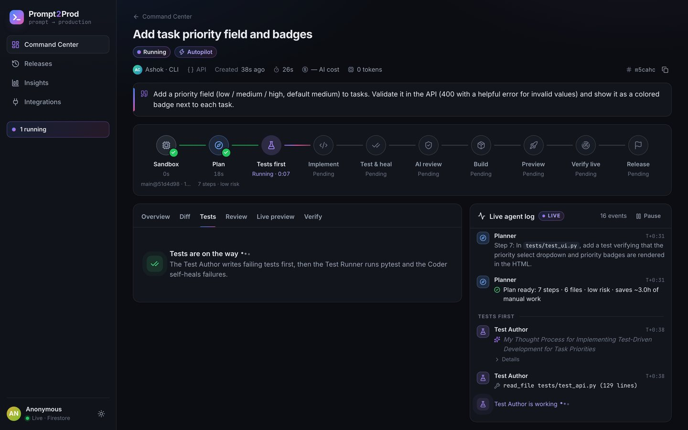
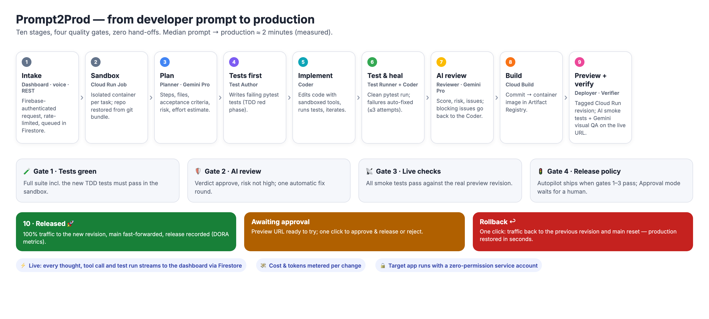
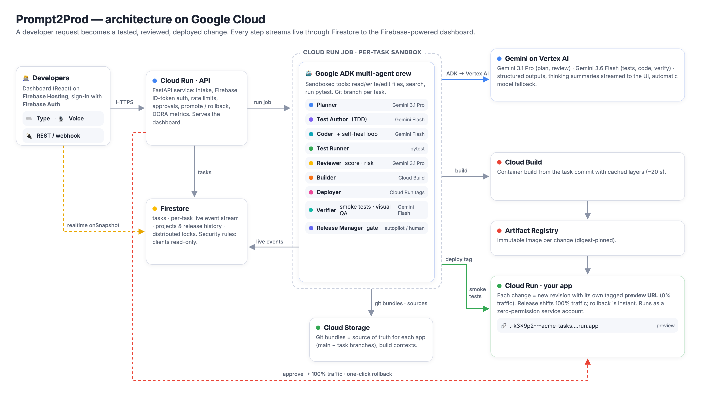
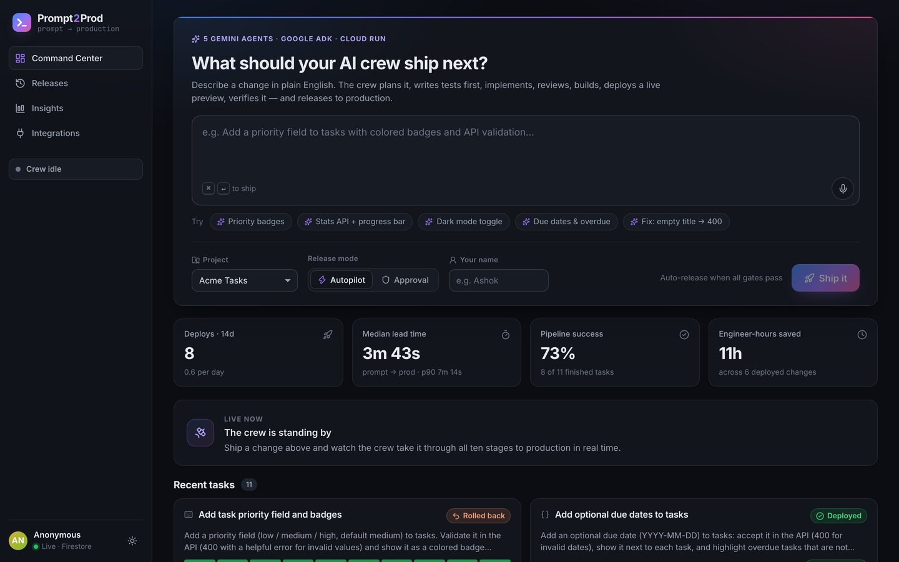
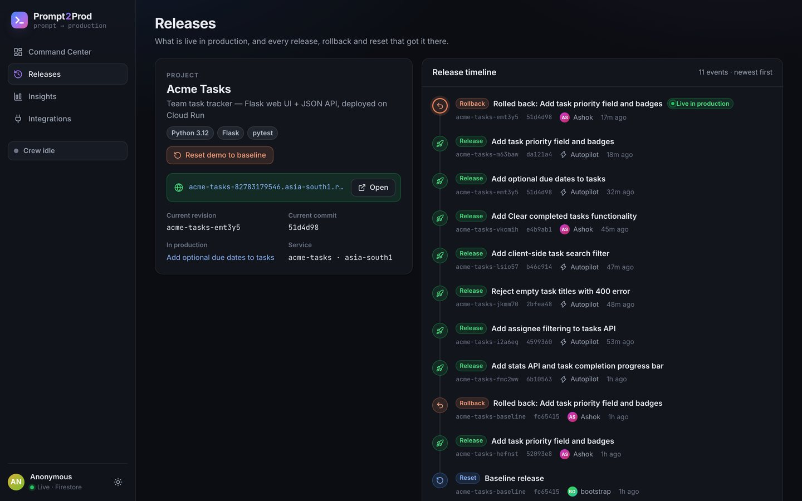
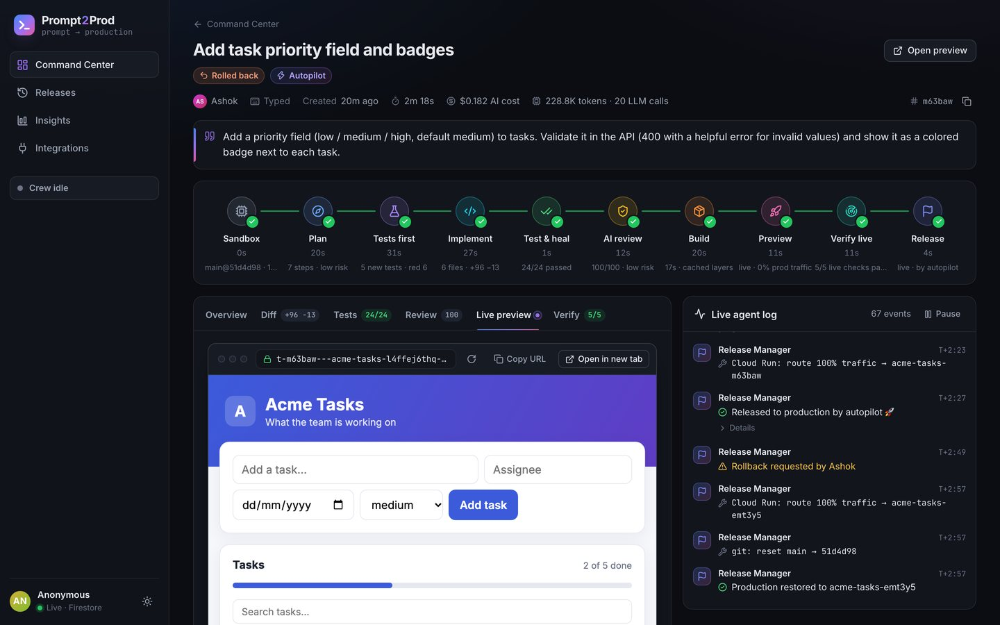
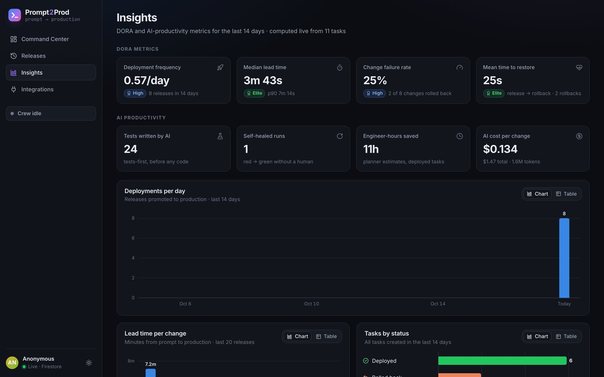

# Prompt2Prod — from a developer's prompt to production

[](https://github.com/ashok2605/prompt2prod/actions/workflows/ci.yml)   

**An autonomous AI dev crew on Google Cloud.** Describe a change in plain English — typed, spoken, or sent from any tool
via REST/webhook — and a team of Gemini agents built with **Google ADK** plans it, writes failing tests first, implements it,
heals its own test failures, reviews the diff, builds it with **Cloud Build**, deploys a **live preview revision on Cloud Run**,
verifies the live preview with AI-generated smoke tests, and releases it to production — automatically (*Autopilot*) or with
one-click human approval. Every thought, tool call and test run streams live to a **Firebase**-powered dashboard through **Firestore**.

> Built for the **Google Cloud × Hack2skill AI Builder Cup 2026** — track *Future of Work & Enterprise Productivity* — by team **Agentic Minds**.

| | |
|---|---|
| 🚀 **Live dashboard** | https://prompt2prod.web.app (Firebase Hosting) · https://prompt2prod-82783179546.asia-south1.run.app (Cloud Run) |
| 🧪 **Demo app the crew evolves** | https://acme-tasks-82783179546.asia-south1.run.app |
| 🎬 **Demo video (3 min)** | https://youtu.be/7gPnEYwUhyk |
| 📊 **Pitch deck** | [docs/Prompt2Prod-AgenticMinds-deck.pdf](docs/Prompt2Prod-AgenticMinds-deck.pdf) |
| 📑 **API docs** | https://prompt2prod-82783179546.asia-south1.run.app/docs |





## Why

Engineers spend most of their week on the toil *around* code — writing tests, waiting for reviews, babysitting builds,
following deploy rituals. Copilots help inside the IDE, and CI/CD runs the pipelines you hand-write, but nobody closes the
loop from *"what I want"* to *"it's live and verified"*. Prompt2Prod does — on real infrastructure, with quality gates on by default.

## How it works

1. **Intake** — a request arrives from the dashboard (keyboard or voice), REST or a webhook. Firebase Auth identifies the
   requester; rate limits protect the budget; the task is queued in Firestore.
2. **Sandbox** — the API starts a **Cloud Run Job** execution: an isolated container per request that restores the app's git
   repository (stored as git bundles in Cloud Storage) on a fresh `task/<id>` branch.
3. **Plan** — the *Planner* (Gemini 3.1 Pro) reads the codebase and `AGENTS.md`, and returns a structured plan: steps, files,
   testable acceptance criteria, risk, effort estimate and commit message. Unsafe / out-of-scope requests are declined.
4. **Tests first** — the *Test Author* (Gemini 3.6 Flash) writes failing pytest tests for the acceptance criteria (TDD red).
   It can only edit `tests/`.
5. **Implement** — the *Coder* edits code through sandboxed tools (`read_file`, `write_file`, `replace_in_file`, `search_code`,
   `run_tests`) and iterates until the suite is green.
6. **Test & heal** — a clean pytest run gates the change; failures go back to the Coder automatically (≤ 3 attempts).
7. **AI review** — the *Reviewer* (Gemini 3.1 Pro) scores the diff 0–100, rates risk and lists issues; blocking issues trigger
   one automatic fix round.
8. **Build** — the commit is built into a container with **Cloud Build** (cached layers, ~20 s) and pushed to **Artifact Registry**.
9. **Preview** — the image is deployed as a new **Cloud Run revision with its own tag** → a unique preview URL with 0% production traffic.
10. **Verify** — the *Verifier* writes HTTP smoke tests from the acceptance criteria and runs them against the live preview,
    re-examining failures against the actual responses (wrong check vs. real defect). It then opens the preview in headless
    Chromium and **Gemini looks at the screenshot** to confirm the UI change visibly landed (multimodal visual QA).
11. **Release** — in *Autopilot*, if tests ✓ review ✓ live checks ✓, the *Release Manager* shifts 100% traffic to the new
    revision and fast-forwards `main`. In *Approval* mode it waits for a human. **Rollback** restores the previous revision
    and resets `main` in seconds.



## Google Cloud & Firebase usage

| Service | How Prompt2Prod uses it |
|---|---|
| **Gemini on Vertex AI** | Gemini 3.1 Pro (Planner, Reviewer) and Gemini 3.6 Flash (Test Author, Coder, Verifier) with structured outputs, per-role thinking levels, thinking summaries streamed to the UI, and automatic model fallback. |
| **Agent Development Kit (ADK)** | Each crew member is an ADK `LlmAgent` (function tools / output schemas) run with `InMemoryRunner`; tool calls and thoughts are mirrored into the live log. |
| **Cloud Run (service)** | FastAPI API + dashboard: intake, Firebase ID-token auth, rate limits, approvals, release/rollback, DORA metrics. |
| **Cloud Run Jobs** | One isolated sandbox execution per request that runs the agents, git and pytest. |
| **Cloud Run revisions & tags** | Every change becomes a tagged revision (preview URL); releases and rollbacks are traffic switches. |
| **Cloud Build + Artifact Registry** | A digest-pinned container image per change, built with layer caching. |
| **Firestore** | Tasks, per-task live event stream (thousands of events/day), projects & release history, distributed locks. |
| **Firebase** | Auth (anonymous sign-in), Hosting (`prompt2prod.web.app`, `/api` rewrites to Cloud Run), JS SDK realtime `onSnapshot` listeners; Firestore security rules make clients read-only. |
| **Cloud Storage** | Git bundles as the source of truth for each app (main + task branches) and build contexts. |
| **IAM** | Least-privilege service accounts; the deployed app runs as a service account with **zero** roles. |

## Measured results

From 9 real end-to-end runs on the demo app (live numbers on the dashboard's *Insights* page):

- **1 m 51 s** median pipeline (plan → tests → code → review → build → preview → verify → release) and **≈ 2.5 min** median
  from prompt to production on Autopilot. The first, untuned run took 5 m 15 s.
- **$0.05 – $0.22** of Gemini tokens per shipped change (16–29 LLM calls, ~120–275K tokens).
- **~20 s** Cloud Build with cached layers, **~11 s** to a live preview revision.
- Every run ended with a green suite including new AI-written tests and a 95–100 AI review score.
- **A real catch:** in task `m5cahc` the Reviewer (Gemini 3.1 Pro) flagged a CSS selector typo (`.new-task` → `.new_task`)
  that would have broken the form styling, something no unit test caught. The Coder fixed it automatically and the re-review approved.

| Command Center | Releases |
|---|---|
|  |  |
| **Live preview in the task view** | **Insights (DORA)** |
|  |  |

## Try it

**Dashboard:** open https://prompt2prod.web.app, type (or say) a change such as
*"Add due dates to tasks and highlight overdue ones in red"*, pick **Autopilot** or **Approval**, press **Ship it** and watch the
crew work. Open the preview URL, approve, check production, roll back — and see the DORA metrics update.

**REST / webhook:**

```bash
curl -X POST https://prompt2prod-82783179546.asia-south1.run.app/api/webhooks/intake \
  -H "X-Intake-Key: REDACTED_INTAKE_KEY" -H "Content-Type: application/json" \
  -d '{"prompt": "Add a GET /api/version endpoint returning the app name and revision", "mode": "approval", "requester": "you"}'
```

**Terminal (developer CLI, standard library only):**

```bash
python cli/p2p.py "Add due dates to tasks and highlight overdue ones in red" --mode approval --name you
#   Planner › Plan ready: 5 steps · 4 files · low risk · saves ~2.5h of manual work
#     Coder › edit app.py (+14 −2)
# ...
# AWAITING_APPROVAL · Add due dates with overdue highlighting
# preview:    https://t-k3x9p2---acme-tasks-….run.app
```

The demo is rate-limited (per user per hour and per day) to protect the free-trial budget. *Releases → Reset demo* restores
the demo app's baseline.

## Quality

- `backend/tests` — unit tests for the safety-critical pieces: workspace path sandboxing, the live-check matcher, the pytest
  sandbox and the DORA metrics (`cd backend && pytest -q`).
- `sample-apps/acme-tasks/tests` — the demo app's own suite, which the crew extends on every change.
- GitHub Actions CI runs both suites and builds the dashboard on every push.

## Repository layout

```
backend/p2p/          FastAPI API, ADK agents, pipeline, Cloud Build/Run control plane, Firestore store
  agents.py           Planner, Test Author, Coder, Reviewer, Verifier (ADK LlmAgents) + sandboxed tools
  pipeline.py         the 10-stage orchestrator with quality gates and live events
  cloud.py            Cloud Build, Cloud Run revisions/tags/traffic, Cloud Run Jobs
  gitrepo.py          git workspaces backed by bundles in Cloud Storage
  release.py          promote / rollback / reset
  runner.py           Cloud Run Job entrypoint (per-project lock, FIFO queue)
  api.py              REST API + dashboard hosting
backend/scripts/      bootstrap a demo project, local runs, watchers
dashboard/            React + Vite dashboard (Firebase Auth + Firestore realtime)
sample-apps/acme-tasks/  the Flask app the crew evolves (with AGENTS.md conventions)
infra/                deploy.sh, Cloud Build configs, Firestore rules, firebase.json
docs/                 SPEC (data model & API contract), diagrams
deck/                 pitch deck builder (official template)
```

## Run it yourself

```bash
# 1. Google Cloud project with billing + Firebase added; gcloud & firebase CLIs authenticated
PROJECT_ID=your-project REGION=asia-south1 ./infra/deploy.sh

# 2. Local development (uses your Application Default Credentials)
python -m venv .venv && . .venv/bin/activate && pip install -r backend/requirements.txt
cd backend && EXECUTION_MODE=inline uvicorn p2p.api:app --reload      # API on :8000
cd dashboard && npm install && VITE_API_BASE=http://localhost:8000 npm run dev
python -m scripts.local_run "Add a /api/version endpoint"               # run one pipeline in-process
```

Models, thinking levels and limits are configurable with environment variables (`PLANNER_MODEL`, `CODER_MODEL`,
`REVIEWER_THINKING`, `LIMIT_PER_DAY`, …) — see `backend/p2p/config.py`.

## Security & guardrails

- Every request runs in its own Cloud Run Job container (gVisor) on a fresh branch; agent tools are confined to the repo
  (path traversal and `.git` blocked); the Test Author can only edit `tests/`.
- The deployed app runs with a zero-permission service account; dashboards get read-only Firestore access via security rules.
- Autopilot only releases when tests, AI review and live checks all pass; Approval mode, Reject and one-click Rollback keep
  humans in control. The Planner declines unsafe or out-of-scope requests.
- Firebase-authenticated intake, per-user/day rate limits, LLM call caps per agent run, and cost metering per change.

## Roadmap

GitHub/GitLab app (issue → PR with preview link), more stacks via buildpacks, Vertex AI Agent Engine for long-running sessions,
codebase RAG with Vertex AI Search, canary releases with SLO-based auto-rollback, policy-as-code guardrails, Slack/Chat intake.

## Team Agentic Minds

Madamanchi Ashok Chowdary (lead) · Venkat Praneeth Reddy
